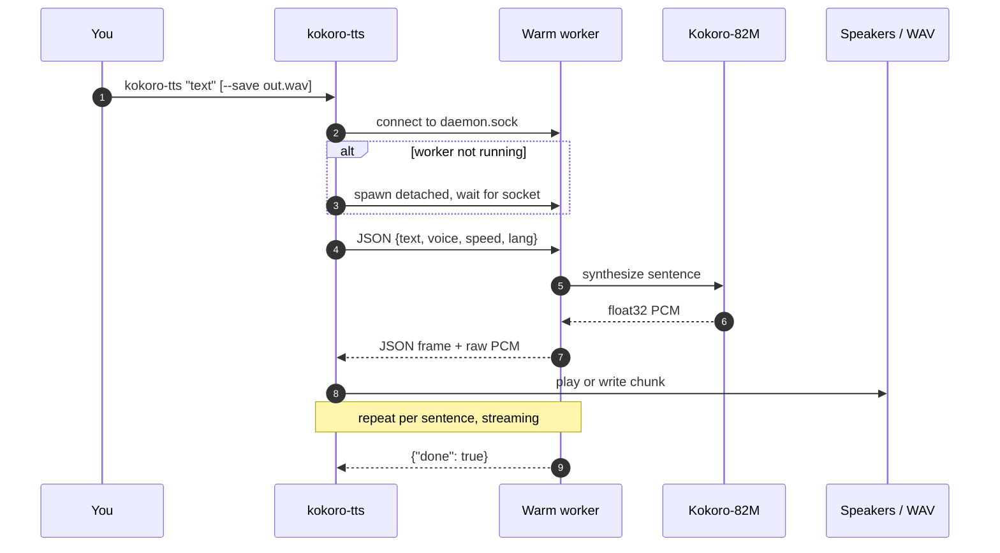

<div align="center">

# 🎙️ kokoro-tts

**Local [Kokoro-82M](https://huggingface.co/hexgrad/Kokoro-82M) text-to-speech that starts speaking before it has finished thinking.**

One command, one warm background worker, no cloud, no API keys, no telemetry.

[](https://www.python.org/)
[](https://huggingface.co/hexgrad/Kokoro-82M)
[](https://docs.astral.sh/uv/)
[](#requirements)
[](#highlights)

<sub>Package `kokoro_mcp` · command `kokoro-tts` · repo `kokoro-mcp`</sub>

</div>

---

**TL;DR**

```bash
uv sync
uv run kokoro-tts "Kokoro runs locally on this machine."
```

The first run downloads the 327 MB checkpoint, then speaks immediately; later calls reuse a
warm worker and start producing audio in about 0.2 s.

<details>
<summary>Table of contents</summary>

- [Highlights](#highlights)
- [Requirements](#requirements)
- [Install](#install)
- [Usage](#usage)
- [How it works](#how-it-works)
- [Latency](#latency)
- [Voices and languages](#voices-and-languages)
- [Speak omp responses](#speak-omp-responses)
- [Configuration](#configuration)
- [Troubleshooting](#troubleshooting)
- [Development](#development)
- [Roadmap](#roadmap)
- [Credits](#credits)

</details>

## Highlights

| | |
|---|---|
| ⚡ **Fast after warm-up** | A persistent worker keeps the model loaded; repeated calls stream in **0.17–0.21 s** on an M4 Pro. |
| 🗣️ **Streams while it synthesizes** | Text is split into sentences; the first sentence plays while the rest is still being generated. |
| 🔒 **Fully local** | Weights and voices live in your HuggingFace cache. No account, API key, or audio leaves the machine. |
| 🎚️ **Voices, speed, languages** | 54 published voices, adjustable rate, and nine languages. |
| 💾 **WAV output** | `--save out.wav` writes 24 kHz mono PCM16 files; multi-chunk text gets numbered files. |
| 🧩 **Speaks agent replies** | A bundled [omp](https://omp.sh) hook speaks a one-sentence recap of every finished response. |

## Requirements

- **macOS or Linux**
- **Python 3.10–3.12** — `uv` installs a compatible interpreter for you
- **[uv](https://docs.astral.sh/uv/)**

Playback uses PortAudio through `sounddevice`; the macOS wheel bundles the library, so there
is nothing to install. `ffplay` is the fallback when PortAudio is unavailable.

## Install

```bash
git clone https://github.com/ofurman/kokoro-tts.git
cd kokoro-tts
uv sync
```

> [!NOTE]
> The first synthesis downloads `kokoro-v1_0.pth` (327 MB) plus the selected voice into
> `~/.cache/huggingface`. Everything after that runs from disk.

### Install as a uv tool

Run `kokoro-tts` from any directory without `uv run`:

```bash
uv tool install .
kokoro-tts "Kokoro runs locally."
```

`uv` puts the executable in `~/.local/bin`. Reinstall after source changes with
`uv tool install --force .`; remove it with `uv tool uninstall kokoro-mcp`. The tool
environment is isolated from `.venv`, so it works outside the checkout and shares the
HuggingFace model cache, but not the repo.

## Usage

```bash
# Play on the speakers (default)
uv run kokoro-tts "Kokoro runs locally on this machine."

# Save to one WAV (relative, absolute and ~ paths all work; parents are created)
uv run kokoro-tts "Kokoro runs locally." --save out.wav
uv run kokoro-tts "Kokoro runs locally." --save /tmp/kokoro/out.wav
uv run kokoro-tts "Kokoro runs locally." --save ~/Desktop/kokoro.wav

# Several sentences: one numbered file per chunk
uv run kokoro-tts "First sentence. Second sentence." --save out.wav
# -> out-001.wav, out-002.wav

# Voice, speed, language
uv run kokoro-tts "Hello there." --voice am_michael --speed 1.15
uv run kokoro-tts "Bonjour tout le monde." --lang f

# Text from a file or stdin
uv run kokoro-tts --text-file script.txt
printf 'Piped text.' | uv run kokoro-tts - --save piped.wav

# Discover voices
uv run kokoro-tts --list-voices

# Skip the background worker (one-shot process, useful for debugging)
uv run kokoro-tts "Kokoro runs locally." --no-daemon
```

A real `--save` run, abridged:

```console
$ uv run kokoro-tts "Kokoro runs locally on this machine. No cloud, no API keys." \
    --save /tmp/kokoro-readme.wav
[1]  2.80s synthesized
[2]  2.45s synthesized
wrote 2 files: /private/tmp/kokoro-readme-001.wav, /private/tmp/kokoro-readme-002.wav
```

| Option | Description | Default |
|---|---|---|
| `TEXT ...` | Text to speak; `-` reads stdin (piped stdin is read automatically) | prompt |
| `--save PATH` | Write WAV files instead of playing; multi-chunk runs become `PATH-001.wav`, … | speakers |
| `--voice VOICE` | Voice id, e.g. `af_heart` or `am_michael` | `af_heart` |
| `--speed FLOAT` | Speaking rate, greater than 0 | `1.0` |
| `--lang CODE` | Language code (`a`–`z`, see [below](#voices-and-languages)) | `a` |
| `--text-file PATH` | Read text from a UTF-8 file | — |
| `--list-voices` | Print voice ids published in the model repo and exit | — |
| `--no-daemon` | Synthesize in-process instead of using the warm worker | worker |
| `--quiet` | Suppress progress messages on stderr | off |

> [!TIP]
> A single chunk keeps the exact path you passed. As soon as a second chunk appears, the first
> file is renamed to `out-001.wav` and the rest follow as `out-002.wav`, and so on.

Progress goes to stderr; each played chunk logs the output device, for example
`played on MacBook Pro Speakers`. If you hear nothing, check that this device is the intended
one in **System Settings → Sound** and that the output volume is up.

## How it works



The first invocation starts the worker as a detached `python -m kokoro_mcp.server`; that call
takes about 5 s including the MPS warm-up. Later invocations connect to the existing worker and
stream chunks in roughly 0.2 s. The worker exits after 30 minutes without requests or on
`SIGTERM`.

It lives in `~/.cache/kokoro-tts/` (`daemon.sock`, `daemon.lock`, `daemon.log`) and holds
about 1.3 GB resident while warm. The socket is user-only (`0600`) and the directory `0700`.
Playback and WAV writing stay in the short-lived CLI, so the audio sinks are unchanged by the
worker.

If MPS misbehaves, set `KOKORO_DEVICE=cpu`: the worker then trades roughly 0.25 s more
synthesis per sentence for a cold start that is 0.5 s shorter. After upgrading the package,
restart a running worker with `pkill -f kokoro_mcp.server` so it runs the new code and protocol.

<details>
<summary>Daemon details</summary>

The worker speaks a line-delimited JSON protocol over a Unix socket: one JSON request per
connection, a JSON header with the protocol version and sample rate, then alternating JSON
frames and raw little-endian float32 PCM. A lock file serializes concurrent first calls so
only one process spawns the worker. If the worker is unreachable, the CLI falls back to
in-process synthesis.

</details>

## Latency

Measured on this M4 Pro, warm HuggingFace cache, saving a 2.9 s sentence:

| Path | Wall time |
|---|---|
| One-shot process (`--no-daemon`) | 4.7 s |
| First call that starts the worker (includes MPS warm-up) | 5.2 s |
| Every later call through the warm worker | 0.17–0.21 s |

The remaining ~0.1 s is synthesis: the worker keeps the model on the MPS backend (0.10 s for
that sentence versus 0.36 s on CPU) and streams float32 PCM as each chunk is produced.

## Voices and languages

`kokoro-tts --list-voices` prints every voice id published in the model repo (a network call on
first use). Voice ids are `lang` + `gender` + name, so `af_heart` is American English, female.

| Code | Language | Notes |
|---|---|---|
| `a` | American English | default (`af_heart`) |
| `b` | British English | |
| `e` | Spanish | |
| `f` | French | |
| `h` | Hindi | |
| `i` | Italian | |
| `j` | Japanese | needs the `misaki[ja]` extras |
| `p` | Brazilian Portuguese | |
| `z` | Mandarin Chinese | needs the `misaki[zh]` extras |

Japanese and Mandarin require the extra misaki extras; the other languages work out of the box.

## Speak omp responses

`integrations/omp/spoken-recap.js` is an [omp](https://omp.sh) hook that speaks the first
sentence of every completed main-session response. It ignores subagent sessions, responses
that continue into another tool loop, and aborted or failed replies.

```bash
mkdir -p ~/.omp/agent/hooks/post
cp integrations/omp/spoken-recap.js ~/.omp/agent/hooks/post/
```

Restart omp. The hook resolves `kokoro-tts` from `~/.local/bin`, then `PATH`.

| Variable | Default | Purpose |
|---|---|---|
| `KOKORO_RECAP` | `1` | Set to `0` to disable speech without removing the hook |
| `KOKORO_RECAP_VOICE` | `af_heart` | Any voice id from `kokoro-tts --list-voices` |
| `KOKORO_RECAP_SPEED` | `1.0` | Speaking rate |
| `KOKORO_TTS_BIN` | auto | Explicit path to the `kokoro-tts` executable |
| `KOKORO_RECAP_HEADLESS` | unset | Set to `1` to also speak in `--print` and RPC runs |

The sentence is extracted locally from the final assistant message, so the hook adds no model
calls. Speech is capped at 200 characters, and a new response interrupts the previous
utterance. Because the hook calls the CLI, it gets the warm worker for free: the first response
after boot waits for the worker, later responses start speaking in about 0.2 s.

## Configuration

| Variable | Default | Purpose |
|---|---|---|
| `KOKORO_DAEMON_DIR` | `~/.cache/kokoro-tts` | Socket, lock and log directory |
| `KOKORO_DAEMON_IDLE` | `1800` | Exit after this many idle seconds; `0` keeps it alive |
| `KOKORO_DEVICE` | `mps` when available | Worker torch device (`cpu` or `mps`) |
| `KOKORO_NO_DAEMON` | unset | Set to `1` to force in-process synthesis |

## Troubleshooting

| Symptom | Fix |
|---|---|
| No sound | The log line names the device. Confirm it is the intended output in System Settings → Sound, and check the volume. |
| First run takes a while | It downloads 327 MB plus the voice. Later runs are fast. |
| MPS crash or garbage audio | `pkill -f kokoro_mcp.server`, then run with `KOKORO_DEVICE=cpu`. |
| Code changed but behavior did not | The old worker is still running; `pkill -f kokoro_mcp.server` restarts it on the next call. |
| Worker will not start | Read `~/.cache/kokoro-tts/daemon.log`; the CLI also prints the last log line when startup fails. |
| No audio output available | Install PortAudio/`sounddevice`, use `--save PATH`, or install `ffmpeg` for the `ffplay` fallback. |
| Japanese or Mandarin fails | Install the matching `misaki` extras (`misaki[ja]`, `misaki[zh]`). |

## Development

```bash
uv run pytest                 # fast unit tests (integration tests are excluded by default)
uv run pytest -m integration  # real model synthesis end to end
```

The integration marker downloads weights on first use; `pyproject.toml` sets
`addopts = "-m 'not integration'"`, so plain `pytest` stays fast.

### Layout

| Path | Role |
|---|---|
| `src/kokoro_mcp/engine.py` | Lazy `KPipeline` wrapper, sentence chunking, voice listing |
| `src/kokoro_mcp/audio.py` | PCM16 WAV writer, PortAudio/`ffplay` speaker stream |
| `src/kokoro_mcp/server.py` | Warm daemon, Unix-socket protocol, on-demand client |
| `src/kokoro_mcp/cli.py` | `kokoro-tts` entry point |
| `integrations/omp/spoken-recap.js` | omp post-hook that speaks response summaries |
| `docs/plans/kokoro-cli/` | The plan this iteration was built against |

## Roadmap

The repo is named `kokoro-mcp` because the MCP server is the intended wrapper. Explicitly
deferred for now:

- An MCP server exposing synthesis to agent clients
- An ONNX Runtime backend, benchmarked against the torch path
- MP3/FLAC output via `ffmpeg`
- Voice blending (`af_heart,af_bella`) and per-voice config defaults

## Credits

Kokoro-82M by [hexgrad](https://huggingface.co/hexgrad) — model weights are Apache-2.0.
Built with the `kokoro` Python package, [misaki](https://github.com/hexgrad/misaki),
`sounddevice`/PortAudio, and espeak-ng. Built for fun; kept because it is useful.
